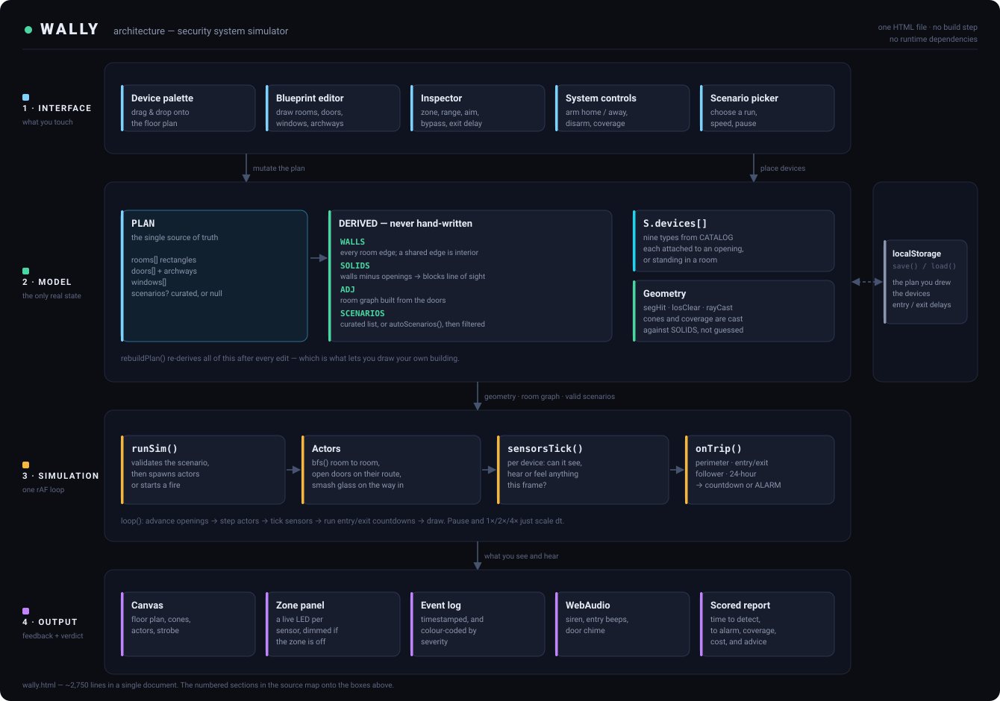

# SST — security system simulator

Design an alarm system for a floor plan, arm it, then run intruders at it and
see whether your design catches them. Use the house it ships with, or draw your
own building.

A single self-contained `SST_Simulator.html` file — markup, styles and script in the same
document, no build step, no package manager, no server, no dependencies.

**Run it:** open [`SST_Simulator.html`](SST_Simulator.html) in a browser (`file://` works), or
serve the folder if you prefer — `python3 -m http.server` then browse to it.

---

## Architecture

The plan is the only thing that is really stored. Walls, the solids that block
line of sight, the room graph and the scenario list are all *derived* from the
rooms and openings, and re-derived after every edit — which is what lets you
draw your own building and have everything downstream still work.

---

## Build

Drag devices from the left palette onto the plan. Nine types, each with a price,
so the design has a budget attached to it:

| Device | Price | Notes |
| --- | --- | --- |
| Control Panel | $199 | Required before the system will arm. One only. |
| Keypad | $59 | Where a resident disarms. Put it near the entry door. |
| Door Contact | $25 | Snaps to a door. Trips when it opens. |
| Window Contact | $25 | Snaps to a window. Trips on open or smash. |
| Motion (PIR) | $45 | Cone of detection, raycast against the walls. |
| Glass Break | $55 | Acoustic, omnidirectional, hears glass smashed in range. |
| Camera | $129 | Records evidence. Only alarms if AI detection is switched on. |
| Siren | $79 | Without one, an alarm is silent. |
| Smoke Detector | $49 | 24-hour zone — fires even when the system is disarmed. |

Contacts refuse to go anywhere except a door or window of the right kind, and
refuse to double up on one that is already covered. Room sensors have to be
inside a room. Everything snaps, and an invalid drop tells you why instead of
silently failing. Drag a placed device back off the plan to delete it.

## Configure

Click a device for the inspector: zone type, range, field of view, aim, pet
immunity, camera AI detection, door chime, and zone bypass. Aim a sensor with
the slider, by dragging the handle on the end of its cone, or with `[` and `]`.

Select a **keypad** and you can program the exit delay from it, the way you
would on a real panel. It is a system-wide setting, so it stays in step with the
Exit delay slider in the sidebar whichever one you move. Set it to zero and
arming takes effect the moment you press Arm.

Detection cones are raycast against the walls, so they spill through doorways
and get cut off by partitions — which is the whole point of placing a sensor
well rather than just dropping it in the middle of a room.

## Arm

The zone model follows how real panels behave:

- **Perimeter** — instant alarm.
- **Entry / Exit** — starts the entry countdown so a resident can reach the keypad.
- **Interior follower** — alarms instantly *unless* an entry delay is already
  running, and is ignored entirely in Arm Home.
- **24-hour** — always live, armed or not.

**Arm Home** watches the perimeter only, so people can move around inside.
**Arm Away** watches everything. Exit and entry delays are adjustable, the panel
refuses to arm while a contact is open, and the monitoring centre is notified a
few seconds into an alarm.

## Simulate

Pick a scenario and press Run:

- Intruder through the front door, the back door, or the garage
- Intruder smashing a living-room or bedroom window
- Two intruders entering at opposite ends of the house
- A resident coming home — does the entry path let them disarm in time?
- A resident already inside, walking from the office to the kitchen — does
  Arm Home actually let someone move around?
- A pet roaming — does your motion configuration false-alarm?
- A kitchen fire — a 24-hour zone test

Actors path-find room to room through the door graph, open doors behind them and
break glass on the way in. You get live zone LEDs, a timestamped event log, a
siren and countdown beeps over WebAudio, and a scored report at the end: time to
detection, time to alarm, camera footage captured, floor coverage, cost, and
specific advice on what to change.

Press **Coverage** at any time for a heatmap of what your motion sensors and
cameras actually see.

## Draw your own plan

Press **Blueprint** to stop using the default house and draw the building
yourself. The left panel becomes a set of tools:

| Tool | Key | What it does |
| --- | --- | --- |
| Select / move | `S` | Rename a room, drag it to move it, drag a corner to resize |
| Room | `R` | Drag out a rectangle on a 10px grid |
| Door | `D` | Click a wall — interior or exterior |
| Archway | `A` | An opening with no door, so nothing to put a contact on |
| Window | `W` | Click an exterior wall |
| Erase | `E` | Click a room or an opening |

A plan is only rooms and openings. **Walls are derived**: put two rooms edge to
edge and the shared edge becomes an interior wall, while anything with open air
on one side is exterior. Doors work out for themselves which two rooms they
join and whether they face outside, and they are named after the room they
serve. Rooms may touch but not overlap, and an opening has to fit inside one
unbroken stretch of wall.

Everything downstream rebuilds from what you draw:

- **Line of sight and sensor cones** are cast against the new walls.
- **The room graph** is rebuilt from the doors, so intruders and residents
  path-find through your layout.
- **The scenario list is regenerated** — one intruder per exterior door, a
  window smash, two intruders at once, a resident arriving, a resident walking
  between the two rooms furthest apart, a pet, and a fire in the largest room.
  An exterior archway counts as a way in, because it is a hole in the wall.
- **Presets become Auto-fit**, which designs a system for the plan you drew
  rather than for the default house.

Devices follow their mounting point: contacts move with their door or window,
and anything whose room or opening you delete is removed with a line in the
event log saying so. Moving a room takes its doors and windows with it;
resizing can leave one with nowhere to sit, and that one is dropped. Corner
handles are only live on the selected room, because rooms that meet at a point
share that corner.

**The first edit you make to the shipped house makes it your own plan.** It
then gets saved with your devices, and the hand-written scenario list that
house came with is replaced by one generated from the rooms and doors that
actually exist — otherwise a scenario could still be pointing at a room you
have just deleted. A scenario is only offered if its entry, its target and the
route between them are all still there.

Press **Done** to go back to building the alarm system. Your plan is saved
alongside your devices, and **Default house** restores the built-in plan.

## Presets and persistence

Three starting points for the default house — Budget ($457), Recommended
($1352), Everything ($2336) — or Auto-fit for a plan you drew. Your layout
*and your plan* are saved to `localStorage` and restored next visit.

## Keys

| Key | Action |
| --- | --- |
| `Del` | Remove the selected device |
| `[` `]` | Rotate the selected device |
| `C` | Toggle the coverage heatmap |
| `Space` | Pause / resume a running scenario |
| `Esc` | Deselect, close a dialog |
| `S` `R` `D` `A` `W` `E` | Blueprint tools: select, room, door, arch, window, erase |

## Worth knowing

**The presets are meant to disagree with each other.** Budget is perimeter-light
and catches a window smash in about 8 seconds, against 1 second for Recommended.
Budget misses the kitchen fire completely, because it has no smoke detectors.
Everything scores *worse* than Recommended on both resident scenarios, because
contacts on interior doors sit on instant perimeter zones. Walk from the office
to the kitchen on Arm Home and Recommended stays silent — the motion sensors see
you and correctly ignore you — while Everything puts the siren on within a
second of the office door opening. More devices is not the same as a better
design.

**A long entry delay is a real trade-off, not a free one.** At the 30-second
default, an intruder through the front door can be in and out before the siren
ever sounds. Shorten it, or put that door on a perimeter zone and accept that
residents have to disarm from outside.

**Coverage percentage is not the score.** A perimeter-first design with modest
interior coverage beats a house full of motion sensors, because it detects at
the boundary instead of after the intruder is already inside.
